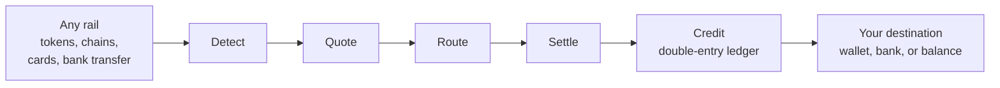

<picture>
  <source media="(prefers-color-scheme: light)" srcset="https://raw.githubusercontent.com/useroutr/.github/main/profile/assets/mark-dark.png">
  
</picture>

# Useroutr

**Universal application funding.** Users bring whatever they have. Your application receives exactly what it needs, credited exactly once.

---

## The problem

Every application that holds value for its users hits the same wall. A user has USDC on Base, or XLM, or a bank account in Lagos. The application needs a specific asset, in a specific place, and needs to know with certainty when to credit that user's balance.

Today that means stitching together a ramp, a bridge, an indexer, and a hand-rolled ledger, then owning every failure mode where they meet. Most teams either accept one token on one chain and lose the rest of their users, or they spend a quarter building payments infrastructure instead of their product.

## What we do

One integration. Users fund from any supported rail, crypto or fiat. You declare where the value should land, and we settle it there and credit it once, with a record that reconciles.



```ts
const intent = await useroutr.fundingIntents.create({
  amount: { amount: "100.00", asset: "fiat:USD" },
  destination: {
    rail: "stellar",
    asset: "crypto:USDC",
    target: { kind: "chain_address", address: "G..." },
  },
  reference: "order_8812",
});
```

Your users never pick a bridge. You never name a provider. Neither of you computes a fee.

## What makes it different

**Funding terminates in a credit, not an address.** A payment is finished when money reaches a wallet. Funding is finished when your application's state changes: a balance rises, credits are granted, a deposit becomes tradeable. That last mile is a double-entry ledger, and it is the product rather than an implementation detail.

**A rail is a rail.** A bank network and a blockchain are modelled as the same kind of object. One type describes a bank account, a blockchain address, and an internal balance, so money out is the same code path as money in.

**One provider interface, across crypto and fiat.** Bridges, DEXs, anchors, ramps, and card acquirers all implement the same contract, declared by capability. The core cannot tell them apart, which is what keeps provider choice from leaking into your application code.

## Repositories

| Repository | Contents |
| --- | --- |
| [useroutr](https://github.com/useroutr/useroutr) | The product. API, workers, ingest, checkout, SDK, and shared packages |
| [contracts](https://github.com/useroutr/contracts) | Soroban and EVM contracts, deployment scripts, audit artifacts |
| [docs](https://github.com/useroutr/docs) | Developer documentation and runnable examples |

## Status

Pre-launch, building toward mainnet. Stellar is our settlement rail, and we are deliberately narrow to start: one funding loop, proven correct, with a ledger that balances and a reconciler that fails loudly when it does not.

Fiat corridors, persistent funding addresses, and payouts follow, on the same core rather than as separate products.

## Contact

Partnership and integration enquiries: [hello@useroutr.com](mailto:hello@useroutr.com)
